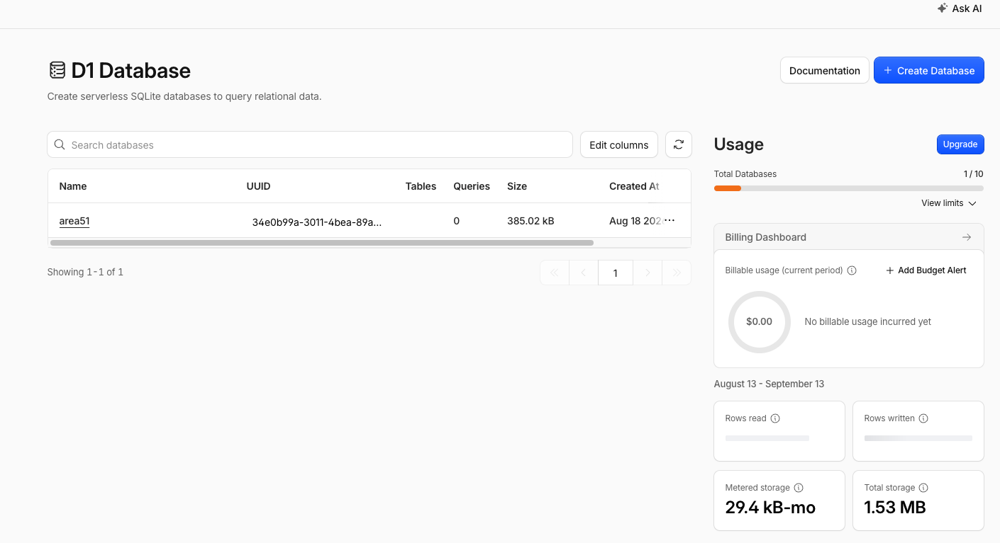
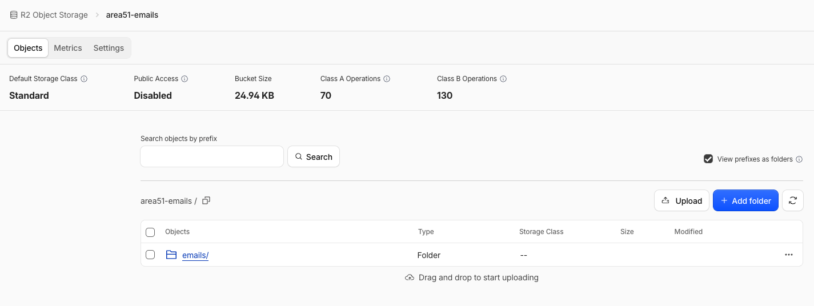
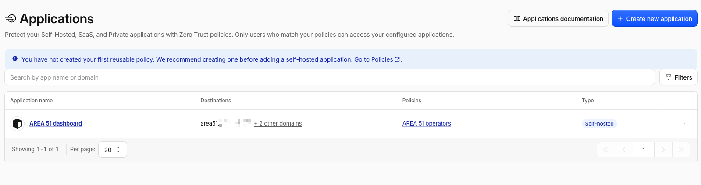
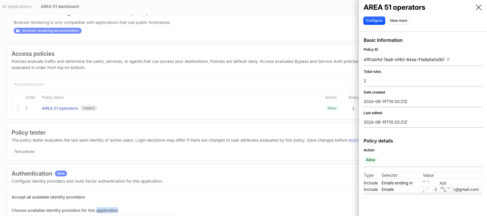
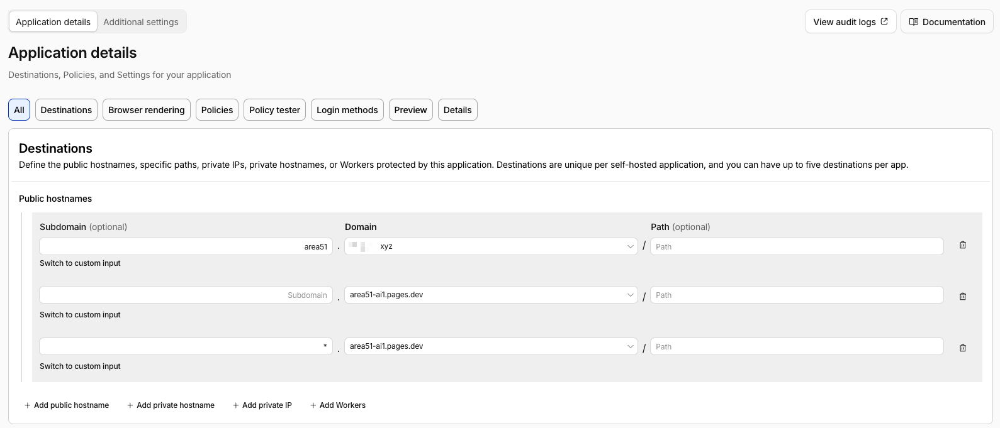
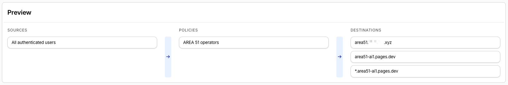

# Deployment reference: a healthy deployment in the Cloudflare dashboard

After `./a51 setup` finishes (and the manual prerequisites are done, see
[getting-started.md](getting-started.md)), this is what a correctly-provisioned AREA 51 deployment
looks like in the Cloudflare dashboard. Use it to eyeball that everything landed;
`./a51 doctor` checks the same things programmatically.

> The screenshots are from a real deployment on a throwaway zone; account ids,
> the zone name and email addresses are partly redacted.

---

## API token

Everything below was provisioned by a single **Account API token**
(Manage Account → API Tokens → Create Token). A correct token carries
**fourteen** permissions in two policies.

**Policy 1, scoped to the account.** Workers Scripts, D1, Workers R2 Storage,
Access: Apps, Access: Policies, Access: Organizations Identity Providers and
Groups, Email Routing Addresses, Zero Trust, all **Write**; Account Settings,
**Read**.

**Policy 2, scoped to the zones you deploy on.** Zone Settings, DNS, Workers
Routes, Email Routing Rules, all **Write**; Zone, **Read**.

A zone that is not listed in policy 2 fails every zone call the same way a
missing permission does, so add a zone there before you add it as a black hole.

---

## Workers

All four Workers, deployed:

- **area51-black-holes** is the public catcher (HTTP + email).
- **area51-autopilot** is the agent-facing REST + MCP server, on its own hostname.
- **area51-cleanup** is the retention worker; **no active routes** (cron only).
- **area51-dashboard** is the dashboard, on the single custom domain
  `area51.<zone>` and **nothing else**: no `*.workers.dev` route and no preview
  URLs, because its config sets `workers_dev = false` and `preview_urls = false`.
  One hostname is the whole point: it is the only thing Access has to guard.

Cloudflare lists all four under **Workers & Pages** in the dashboard sidebar.

---

## D1 database

One database named `area51`, and only one. This is the account-level list, so
what it confirms is that setup created exactly one and did not leave a duplicate
behind:



The *Tables* column is blank here because Cloudflare populates it lazily; it is
not evidence of an empty database. Inside are the seven tables from
[db/schema.sql](../../db/schema.sql), holding metadata only and no message bodies.
`./a51 doctor` is what actually verifies the schema, naming any table or
late-added column that is missing, plus every binding onto the database.

---

## R2 object storage

Captured email lives in the **area51-emails** bucket, with **Public Access
Disabled** and the verbatim `.eml` objects under the `emails/` prefix:



There is a second bucket, **area51-files**, for file-backed endpoint uploads
(not shown). Both are private, so nothing in R2 is publicly reachable.

---

## Cloudflare Access (Zero Trust)

Access is the dashboard's **only** authentication. These three views confirm it
is configured correctly.

### The application

A self-hosted application, **AREA 51 dashboard**, with an **AREA 51 operators**
allow policy. Destinations lists exactly one hostname:



### The allow policy

Default-deny, with one **Allow** policy holding a single include rule: *emails in
a list*, pointing at the Zero Trust email list named by `ACCESS_LIST_ID`. The
addresses in that list are a projection of the `email` column of the D1 `users`
table, replaced wholesale by `./a51 users` on every add and remove, so editing
the list here does not survive the next command. Only those identities get a
one-time PIN and in:



### Destinations

One public hostname destination: `area51.<zone>`, the dashboard's Custom Domain.



One name is all the Worker answers on, so one destination is all Access has to
guard. If you see more than one, something added it: AREA 51 never removes a
destination it did not add, so take the extra ones off here when nothing needs
them.

### Preview

The end-to-end summary: **all authenticated users** matching the **AREA 51
operators** policy may reach the destination:



---

## Cross-check with the CLI

Everything above is what these commands assert without opening the dashboard:

```bash
./a51 status     # what is deployed, and where
./a51 doctor     # every binding, domain, policy, and probes the live hosts
```

`doctor` specifically confirms all four Workers' bindings (the dashboard's `DB`,
`EML` and `FILES` among them), the D1 schema, both R2 buckets, the dashboard's
Custom Domain, and the Access application with its allow policy.
